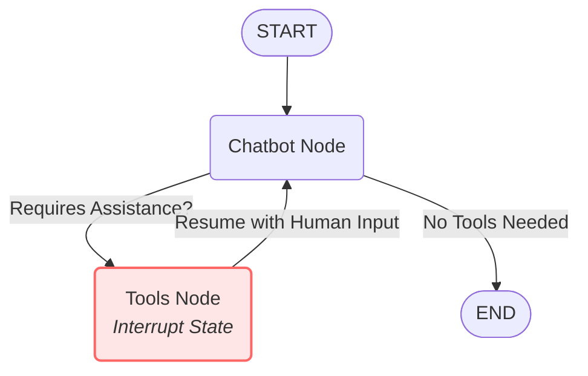

# LangGraph Human-in-the-Loop Checkpointing with MongoDB

This project demonstrates the implementation of a conversational AI agent using LangGraph, featuring human-in-the-loop (HITL) capabilities and persistent state checkpointing with MongoDB. 

## Overview

The application creates a state graph for a chatbot that can invoke a `human_assistance_tool`. When the AI agent encounters an issue or requires human guidance, the graph execution is interrupted, and the internal state is seamlessly saved to a local MongoDB database using `MongoDBSaver`.

A human operator can later step in, provide the necessary information or context to resolve the query, and the LangGraph workflow resumes exactly where it left off.

### Graph Architecture

Here is the graphical representation of the workflow implemented in `app/graph.py`:



## Why Use a Checkpointer?

In LangGraph, a checkpointer (such as the `MongoDBSaver` used in this project) is essential for several reasons:
- **Human-in-the-Loop (HITL):** It enables the graph execution to be safely paused (using an `interrupt`) when human guidance is needed. The checkpointer serializes and saves the exact state, allowing the workflow to resume seamlessly once the human provides input.
- **State Persistence (Memory):** It maintains the state or memory across different interactions. Since LLMs are stateless, saving a unique `thread_id` to the database allows the agent to remember the conversation history.
- **Fault Tolerance & Time Travel:** The checkpointer ensures workflow states are safely backed up in a database. Not only does this prevent data loss if the server restarts, but it also allows developers to "time travel" (replay or rewind execution from specific graph nodes).

## Project Structure

- `app/graph.py`: Defines the LangGraph state machine. It includes the logic for the `chatbot` node, the tools node with the `human_assistance_tool` containing the `interrupt` function, and compiles the overall execution graph.
- `app/main.py` & `app/support.py`: Initialization scripts. These set up the graph with the MongoDB checkpointer, load a specific execution thread (`thread_id`), capture the user's query needing assistance, prompt for a human resolution, and subsequently resume the AI graph and return the stream.
- `docker-compose.yml`: A simple Docker Compose configuration to immediately run a MongoDB instance for checkpointing.
- `requirements.txt`: Project's Python dependencies.
- `.env`: Environment variables (e.g., `OPENAI_API_KEY`) loaded to run the graph nodes properly.

## Requirements

- Python 3.8+
- Docker & Docker Compose
- API Key from a Supported LLM Provider (e.g., OpenAI)

## Getting Started

1. **Spin up MongoDB Checkpoint Database:**
   Use Docker Compose to run a local MongoDB instance.
   ```bash
   docker-compose up -d
   ```

2. **Install the Dependencies:**
   Create a virtual environment, then install all project dependencies.
   ```bash
   pip install -r requirements.txt
   ```

3. **Configure Environment Variables:**
   Create a `.env` file within your `app/` folder (or project root, as expected) and store any necessary API keys.
   ```env
   OPENAI_API_KEY=your_openai_api_key_here
   ```

4. **Running the Flow:**
   You can initiate and interact with the frozen state inside the MongoDB server by executing the scripts:
   ```bash
   python -m app.main
   ```
   *Note: Ensure your MongoDB server is healthy. The agent will read its current `thread_id` properties, and once the interruption is hit, it will prompt you (`Resolution >`) for further guidance.*
