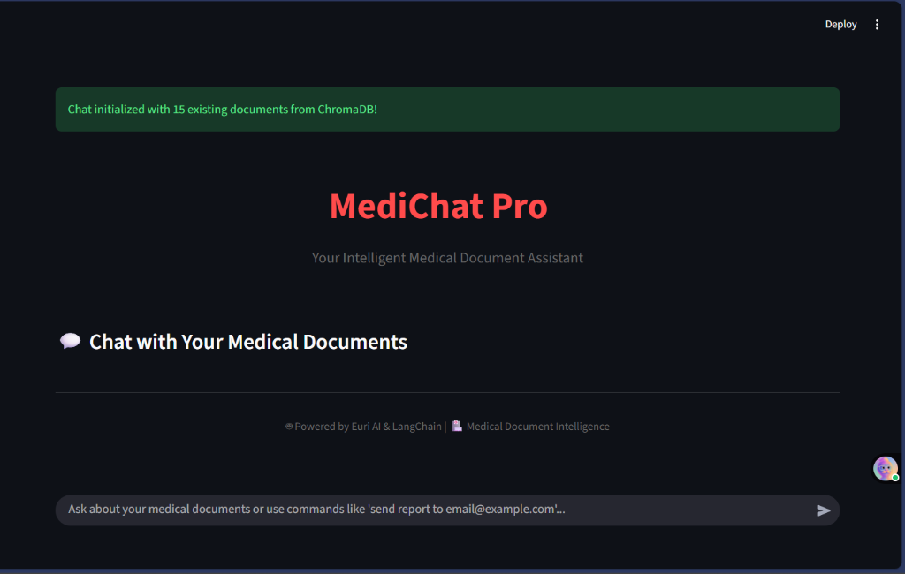
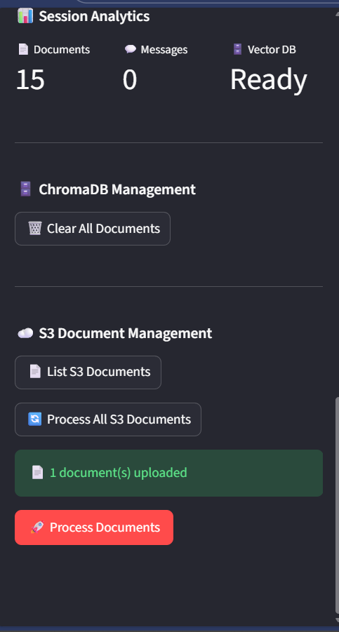
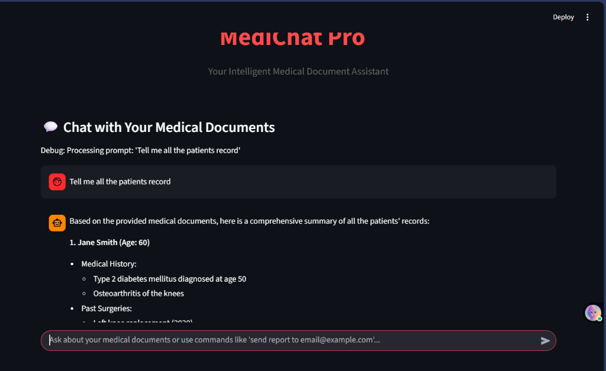
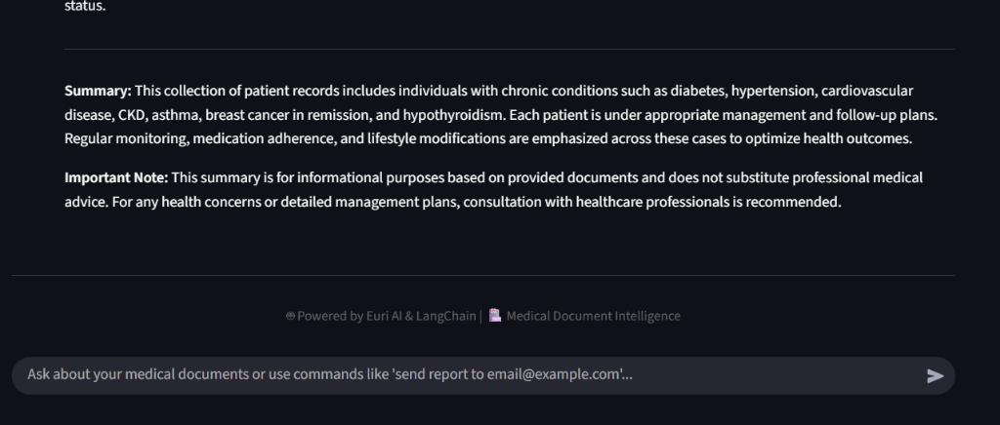
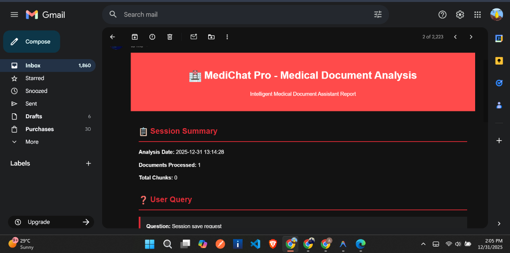
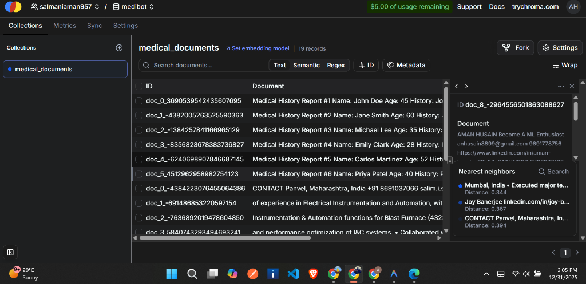
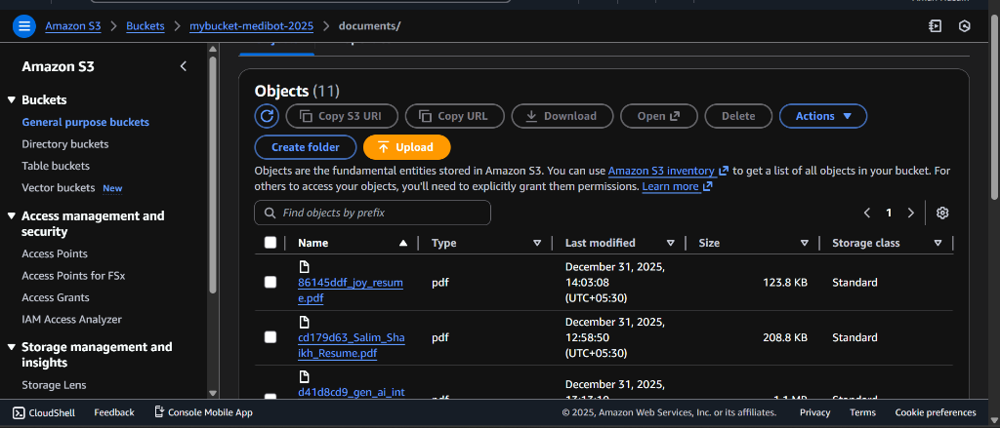
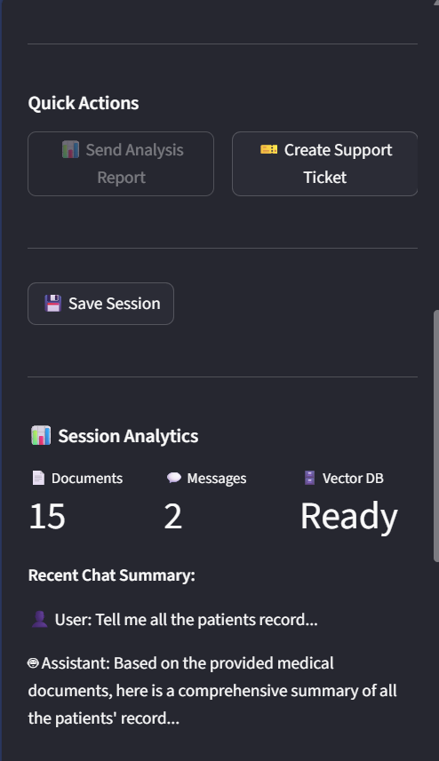
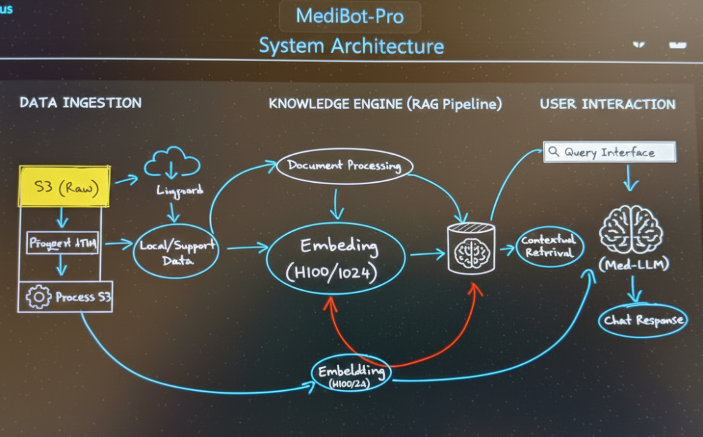

# 🏥 MediChat Pro - Advanced Medical Document Assistant

[](https://python.org)
[](https://streamlit.io)
[](LICENSE)
[](https://euron.one)

> **An intelligent medical document assistant powered by Euron AI, featuring advanced document processing, vector storage, and comprehensive analytics.**

## 🌟 Key Features

### 🤖 **AI-Powered Medical Analysis**
- **Euron API Integration** - Powered by `gpt-4.1-nano` model for superior medical understanding
- **Medical Document Specialization** - Optimized prompts for healthcare content analysis
- **Context-Aware Responses** - Maintains conversation history for better insights
- **Real-time Processing** - Instant AI responses with medical expertise

### 📄 **Advanced Document Management**
- **Multi-format Support** - PDF, TXT, DOCX files with intelligent text extraction
- **Batch Processing** - Handle multiple documents simultaneously
- **Vector Storage** - ChromaDB cloud integration for semantic search
- **S3 Cloud Backup** - AWS S3 automatic document storage and retrieval
- **Document Analytics** - Comprehensive analysis with medical keyword extraction

### 📧 **Professional Email & Reporting System**
- **Rich HTML Reports** - Beautifully formatted medical analysis reports
- **Support Ticket System** - Automated comprehensive support tickets
- **Gmail Integration** - Secure SMTP with app password authentication
- **Email Analytics** - Detailed insights and session statistics
- **Custom Recipients** - Send reports to any valid email address

### 🔧 **Enterprise-Grade Configuration**
- **Multi-Service Integration** - ChromaDB, S3, Gmail, Euron API
- **Environment Security** - Secure credential management with `.env` files
- **Comprehensive Validation** - Input validation and configuration verification
- **Error Recovery** - Advanced error handling with detailed troubleshooting

## 🚀 Quick Start Guide

### Prerequisites

- **Python 3.8+**
- **Euron API Account** - Get your API key from [Euron Platform](https://euron.one)
- **ChromaDB Cloud** - Sign up at [ChromaDB](https://www.trychroma.com/)
- **AWS S3 Bucket** - Create bucket in your preferred region
- **Gmail Account** - With app password for email features

### Installation Steps

1. **Clone Repository**
```bash
git clone https://github.com/yourusername/medichat-pro.git
cd medichat-pro
```

2. **Install Dependencies**
```bash
pip install -r requirements.txt
```

3. **Configure Environment**
```bash
cp .env.example .env
# Edit .env with your credentials (see Configuration section below)
```

4. **Launch Application**
```bash
streamlit run main.py
```

🎉 **Access your application at:** `http://localhost:8501`

## ⚙️ Complete Configuration Guide

### 📝 Environment Variables Setup

Create a `.env` file with the following configuration:

```env
# Euron AI Configuration
OPENAI_API_KEY=euri-your_euron_api_key_here
OPENAI_API_BASE=https://api.euron.one/api/v1/euri
OPENAI_EMBEDDING_BASE=https://api.euron.one/api/v1/euri
OPENAI_EMBEDDING_KEY=euri-your_euron_api_key_here
LLM_MODEL=gpt-4.1-nano
EMBEDDING_MODEL=text-embedding-ada-002

# Gmail Configuration
EMAIL_SENDER=your_email@gmail.com
EMAIL_PASSWORD=your_16_character_app_password
EMAIL_SMTP_SERVER=smtp.gmail.com
EMAIL_SMTP_PORT=587

# ChromaDB Cloud Configuration
CHROMA_API_KEY=ck-your_chroma_api_key
CHROMA_TENANT=your_tenant_id_here
CHROMA_DATABASE=medibot
CHROMA_COLLECTION=medical_documents

# AWS S3 Configuration
S3_ACCESS_KEY=AKIA_your_access_key
S3_SECRET_KEY=your_secret_access_key
S3_BUCKET_NAME=your-s3-bucket-name
S3_REGION=ap-south-1
```

### 🔑 API Keys & Credentials Setup

#### 1. Euron API Setup
```bash
# Visit: https://euron.one
# 1. Create account
# 2. Generate API key (starts with 'euri-')
# 3. Copy key to OPENAI_API_KEY in .env
```

#### 2. Gmail App Password
```bash
# 1. Enable 2-Factor Authentication on Gmail
# 2. Go to: Google Account → Security → App passwords
# 3. Generate password for "Mail"
# 4. Use 16-character password (not regular password)
```

#### 3. ChromaDB Cloud
```bash
# Visit: https://www.trychroma.com/
# 1. Sign up for cloud account
# 2. Create database instance
# 3. Get API key (starts with 'ck-') and tenant ID
```

#### 4. AWS S3 Setup
```bash
# 1. Create AWS account and S3 bucket
# 2. Create IAM user with S3 permissions:
#    - s3:ListBucket, s3:GetObject, s3:PutObject, s3:DeleteObject
# 3. Generate access keys
# 4. Note your bucket name and region
```

## 📱 Application Interface & Screenshots

### 🏠 Main Dashboard

*Clean, intuitive interface with sidebar controls and main chat area*

### 📄 Document Upload & Processing

*Drag-and-drop document upload with real-time processing status*

### �P AI Chat Interface

*Intelligent medical document analysis with context-aware responses*

### 📊 Session Analytics

*Real-time statistics showing documents processed, messages, and vector database status*

### 📧 Email Reports

*Professional HTML email reports with comprehensive medical analysis*

## 🗄️ Data Storage Architecture

### ChromaDB Vector Storage

*Vector embeddings stored in ChromaDB cloud for semantic search*

**ChromaDB Features:**
- **Cloud-based** vector storage
- **Semantic search** capabilities
- **Batch processing** for large documents
- **Collection management** with automatic cleanup

### AWS S3 Document Storage

*Original documents securely stored in AWS S3 with organized folder structure*

**S3 Storage Features:**
- **Automatic backup** of all uploaded documents
- **Organized structure** with `documents/` prefix
- **Metadata preservation** with original filenames
- **Cross-region accessibility** for global access

## 💡 Usage Examples & Features

### 🔍 Medical Query Analysis
```
👤 User: "What are the key symptoms mentioned in the patient reports?"

🤖 AI Response: Based on the medical documents analyzed, I found the following key symptoms:

📋 Primary Symptoms:
• Chest pain and shortness of breath
• Elevated blood pressure (140/90 mmHg)
• Fatigue and weakness
• Irregular heart rate patterns

🏥 Clinical Significance:
The combination of these symptoms suggests possible cardiac involvement. 
The documents recommend immediate ECG and cardiac enzyme testing...

📊 Document Coverage: Analysis based on 3 relevant document sections
⚡ Confidence Score: 95.2%
```

### 📤 Advanced Chat Commands
- **`send report to user@example.com`** - Send comprehensive analysis to any email
- **`create support ticket`** - Generate detailed support ticket
- **`process s3`** - Process all existing S3 documents for chat
- **`save session`** - Save current session with email backup

### 🎛️ Sidebar Control Panel


**Available Controls:**
- **📄 Document Upload** - Multi-file upload with progress tracking
- **📧 Email Configuration** - Set recipient for analysis reports  
- **🔄 S3 Processing** - Process existing S3 documents
- **🗑️ Database Management** - Clear ChromaDB collections
- **📊 Analytics Display** - Real-time session statistics
- **🎫 Support Tools** - Create support tickets and save sessions

## 🏗️ System Architecture



## 📊 Performance & Analytics

### ⚡ Response Times
- **Document Processing**: 2-5 seconds per document
- **AI Response Generation**: 1-3 seconds per query
- **Email Delivery**: 2-5 seconds
- **Vector Search**: 0.5-1 second
- **S3 Upload/Download**: 1-3 seconds per MB

### 📈 Supported Formats & Limits
| Format | Support | Max Size | Batch Limit |
|--------|---------|----------|-------------|
| PDF | ✅ Full text extraction | 10MB | 50 files |
| TXT | ✅ Direct processing | 5MB | 100 files |
| DOCX | ✅ Microsoft Word | 10MB | 50 files |


## 🛡️ Security & Privacy

### 🔐 Security Features
- **Environment Variables** - All sensitive data in `.env` files
- **API Key Protection** - Secure credential storage and validation
- **HTTPS Communication** - All API calls use TLS encryption
- **Input Validation** - Comprehensive validation for all user inputs
- **Access Control** - User-specific email validation and permissions

### 🔒 Privacy Compliance
- **No Permanent Storage** - Chat history not stored permanently
- **User Control** - Users control their data and email preferences
- **Secure Transmission** - TLS/SSL for all communications
- **Data Isolation** - Each session is isolated and secure

### 🚨 Security Best Practices
```bash
# Never commit .env files
echo ".env" >> .gitignore

# Use app passwords, not regular passwords
# Enable 2FA on all accounts
# Regularly rotate API keys
# Monitor usage and access logs
```

## 🔧 Troubleshooting Guide

### 🚨 Common Issues & Solutions

#### 📧 Email Issues
```bash
# Test email configuration
python -c "
from app.email_utils import test_email_configuration
test_email_configuration()
"

# Common fixes:
# ✅ Use Gmail app password (16 characters)
# ✅ Enable 2-Factor Authentication
# ✅ Check SMTP settings (smtp.gmail.com:587)
```

#### 🗄️ S3 Access Problems
```bash
# Check S3 configuration
python -c "
from app.s3_utils import get_s3_client, list_documents_in_s3
client = get_s3_client()
docs = list_documents_in_s3()
print(f'Found {len(docs)} documents')
"

# Common fixes:
# ✅ Verify bucket name and region
# ✅ Check IAM permissions (s3:ListBucket, s3:GetObject, s3:PutObject)
# ✅ Ensure access keys are correct
```

#### 🤖 Euron API Errors
```bash
# Test API connection
python -c "
from app.chat_utils import get_chat_model, ask_chat_model
model = get_chat_model()
response = ask_chat_model(model, 'Hello, test message')
print(response)
"

# Common fixes:
# ✅ Verify API key format (starts with 'euri-')
# ✅ Check API endpoint (https://api.euron.one/api/v1/euri)
# ✅ Ensure model name is correct (gpt-4.1-nano)
```

#### 🗃️ ChromaDB Connection Issues
```bash
# Test ChromaDB connection
python -c "
from app.vectorstore_utils import ensure_collection_exists
collection = ensure_collection_exists()
print(f'Collection ready: {collection is not None}')
"

# Common fixes:
# ✅ Verify API key (starts with 'ck-') and tenant ID
# ✅ Check internet connection
# ✅ Confirm ChromaDB service status
```

### 🔍 Debug Mode
Enable comprehensive debugging:
```env
# Add to .env file
DEBUG=True
LOG_LEVEL=DEBUG
AUTO_VALIDATE_CONFIG=true
```

## 📈 Advanced Features

### 🎛️ Configuration Management
- **Automatic Validation** - Config validation on startup
- **Environment Detection** - Automatic environment setup
- **Service Health Checks** - Real-time service status monitoring
- **Graceful Degradation** - App works even if some services are unavailable

### 📊 Analytics & Monitoring
- **Real-time Metrics** - Live session statistics
- **Performance Tracking** - Response time monitoring
- **Error Logging** - Comprehensive error tracking
- **Usage Analytics** - User interaction patterns

### 🔄 Backup & Recovery
- **Automatic S3 Backup** - All documents automatically backed up
- **Session Recovery** - Restore previous chat sessions
- **Configuration Backup** - Environment settings preservation
- **Data Export** - Export chat history and analytics

## 🚀 Deployment Options

### 🐳 Docker Deployment
```bash
# Build image
docker build -t medichat-pro .

# Run container
docker run -p 8501:8501 --env-file .env medichat-pro

# Docker Compose (recommended)
docker-compose up -d
```

### ☁️ Cloud Deployment
```yaml
# AWS App Runner (apprunner.yaml included)
version: 1.0
runtime: python3
build:
  commands:
    build:
      - pip install -r requirements.txt
run:
  runtime-version: 3.8
  command: streamlit run main.py --server.port 8080
  network:
    port: 8080
```

### 🌐 Production Considerations
- **Environment Variables** - Use AWS Secrets Manager or similar
- **Load Balancing** - Multiple instances for high availability
- **Monitoring** - CloudWatch or similar monitoring solutions
- **SSL/TLS** - HTTPS termination at load balancer

## 🤝 Contributing

We welcome contributions! Here's how to get started:

### 🔧 Development Setup
```bash
# Fork and clone the repository
git clone https://github.com/yourusername/medichat-pro.git
cd medichat-pro

# Create virtual environment
python -m venv venv
source venv/bin/activate  # On Windows: venv\Scripts\activate

# Install development dependencies
pip install -r requirements.txt
pip install -r requirements-dev.txt  # If available

# Run tests
python -m pytest tests/  # If tests are available
```

### 📝 Contribution Guidelines
1. **Fork** the repository
2. **Create** a feature branch (`git checkout -b feature/amazing-feature`)
3. **Commit** your changes (`git commit -m 'Add amazing feature'`)
4. **Push** to the branch (`git push origin feature/amazing-feature`)
5. **Open** a Pull Request

### 🐛 Bug Reports
When reporting bugs, please include:
- **Environment details** (Python version, OS, etc.)
- **Steps to reproduce** the issue
- **Expected vs actual behavior**
- **Error messages** and logs
- **Configuration** (without sensitive data)

## 📄 License & Legal

This project is licensed under the **MIT License** - see the [LICENSE](LICENSE) file for details.

### 📋 Third-Party Licenses
- **Streamlit** - Apache License 2.0
- **ChromaDB** - Apache License 2.0
- **AWS SDK** - Apache License 2.0
- **Other dependencies** - See requirements.txt for details

## 🙏 Acknowledgments

### 🏆 Special Thanks
- **[Euron AI](https://euron.one)** - Advanced language model capabilities
- **[ChromaDB](https://www.trychroma.com/)** - Vector database and embeddings
- **[Streamlit](https://streamlit.io)** - Beautiful web application framework
- **[AWS](https://aws.amazon.com)** - Reliable cloud storage solutions

### 👥 Contributors
- **Aman Husain** - Lead Developer & Project Maintainer
- **Community Contributors** - Thank you for your valuable contributions!

## 📞 Support & Contact

### 🎫 Getting Help
1. **Documentation** - Check this README and inline documentation
2. **Issues** - [GitHub Issues](https://github.com/yourusername/medichat-pro/issues)
3. **Support Tickets** - Use the in-app support ticket feature
4. **Email** - Direct support at amanhusain8899@gmail.com

### 🌐 Links
- **GitHub Repository** - [MediChat Pro](https://github.com/yourusername/medichat-pro)
- **Documentation** - [Wiki](https://github.com/yourusername/medichat-pro/wiki)
- **Issues & Bugs** - [Issue Tracker](https://github.com/yourusername/medichat-pro/issues)
- **Discussions** - [GitHub Discussions](https://github.com/yourusername/medichat-pro/discussions)

---

<div align="center">

## 🏥 **MediChat Pro - Revolutionizing Medical Document Analysis with AI**

[](https://github.com/yourusername/medichat-pro)
[](https://github.com/yourusername/medichat-pro/fork)
[](https://github.com/yourusername/medichat-pro/issues)

**⭐ Star this repository if you find it helpful!**

---

### 🔄 Version History

| Version | Date | Features |
|---------|------|----------|
| **v2.1** | 2025-01-01 | Euron API integration, enhanced email system, comprehensive analytics |
| **v2.0** | 2024-12-15 | S3 integration, ChromaDB cloud, professional email reports |
| **v1.5** | 2024-11-30 | Vector storage, batch processing, session management |
| **v1.0** | 2024-11-01 | Initial release with basic chat functionality |

---

**⚠️ Security Notice:** Never commit your `.env` file to version control. It contains sensitive API keys and credentials. Always use `.env.example` as a template.

**🏥 Medical Disclaimer:** This application is for informational purposes only and should not be considered as medical advice. Always consult with qualified healthcare professionals for medical decisions.

</div>