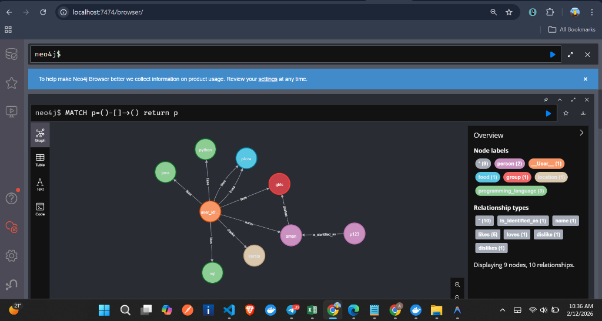
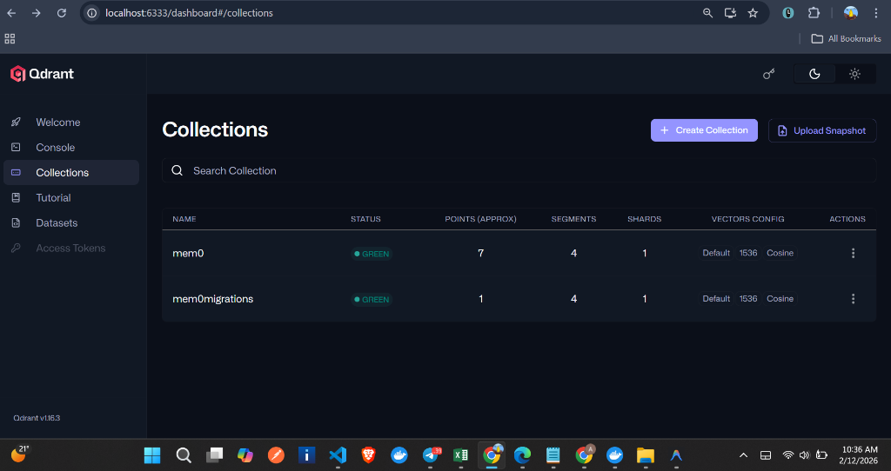

# Knowledge Graph Memory Agent

This project implements a memory-aware chat agent using **Mem0**, **Qdrant**, and **Neo4j**. It leverages a vector store (Qdrant) for semantic search and a graph store (Neo4j) to capture and reason over relationships between memories, providing a richer context for the LLM.

## Features

- **Hybrid Memory**: Combines vector embeddings (Qdrant) and knowledge graphs (Neo4j) for robust memory retrieval.
- **Context-Aware Chat**: The agent retrieves relevant past memories to inform its responses.
- **Automated Fact Extraction**: Interactions are automatically analyzed to extract facts and update the knowledge graph.
- **Dockerized Infrastructure**: Easy setup of Qdrant and Neo4j using Docker Compose.

## Prerequisites

- Python 3.8+
- Docker & Docker Compose
- OpenAI API Key

## Installation

1.  **Clone the repository** (if applicable) or navigate to the project directory.

2.  **Install Python dependencies**:
    It is recommended to use a virtual environment.
    ```bash
    pip install mem0ai openai python-dotenv
    ```

3.  **Set up Environment Variables**:
    Create a `.env` file in the root directory with the following variables:
    ```env
    OPENAI_API_KEY=your_openai_api_key_here
    QDRANT_HOST=localhost
    NEO4J_URL=bolt://localhost:7687
    NEO4J_USERNAME=neo4j
    NEO4J_PASSWORD=reform-william-center-vibrate-press-5829
    ```
    > **Note:** The Neo4j password provided here matches the one configured in `docker.compose.yml`. Change it in both files if you wish to use a custom password.

## Usage

1.  **Start the Infrastructure**:
    Run the Docker containers for Qdrant and Neo4j.
    ```bash
    docker-compose -f docker.compose.yml up -d
    ```

2.  **Run the Chat Agent**:
    Execute the Python script to start the interactive chat loop.
    ```bash
    python mem.py
    ```

3.  **Interact**:
    Type your messages in the console. The bot will respond based on the context of your conversation and stored memories.

## Project Structure

- `mem.py`: The main script that initializes the memory client, connects to the stores, and runs the chat loop.
- `docker.compose.yml`: Configuration for running Qdrant and Neo4j containers.
- `index.ipynb`: Jupyter notebook for experimentation (optional).

## Configuration

The `mem.py` file contains the configuration for the `Memory` client:
- **LLM**: Uses `gpt-4.1` (ensure you have access or change this to `gpt-4-turbo` / `gpt-3.5-turbo`).
- **Embedder**: Uses `text-embedding-3-small`.
- **Vector Store**: Qdrant on port 6333.
- **Graph Store**: Neo4j on port 7687.

## Visualizations

### Neo4j Graph View
This view shows the nodes and relationships created in the Neo4j database, visualizing the connections between different entities.


### Qdrant Dashboard
The Qdrant dashboard displays the collections and vector points stored in the vector database.

