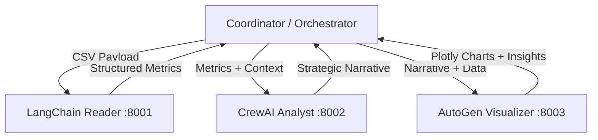

# Sales & Marketing A2A Multi-Agent Orchestration

This project showcases a powerful Agent-to-Agent (A2A) workflow that coordinates three distinct AI frameworks—LangChain, CrewAI, and AutoGen—using the A2A SDK. 

The system operates over a networked JSON-RPC architecture, where each agent exposes an A2A-compliant endpoint. These agents seamlessly pass structured messages and data payloads to collaboratively analyze sales and marketing data, generate insights, and create visual artifacts.

## ✨ Agent Roles

1. **LangChain Reader (Port 8001)**  
   Ingests the raw sales and marketing dataset (CSV) and emits structured metrics and summary statistics.
2. **CrewAI Analyst (Port 8002)**  
   Transforms the metrics and outputs from the Reader into strategic, decision-ready marketing recommendations.
3. **AutoGen Visualizer (Port 8003)**  
   Acts on the analyst's recommendations to generate Plotly charts and fine analytics. It leverages tool calls to produce tangible visual artifacts.

Outputs from every agent are rendered in a dynamic **Streamlit UI**, allowing users to inspect the entire conversation timeline as well as agent-specific deliverables.

---

## 🚀 Architecture & Data Flow



Every hop exchanges A2A `Message` objects with the earlier agent’s structured payload serialized in `DataPart`s, preserving pure function-based logic. The endpoints expose the agent card natively at the root paths.

---

## 🛠️ Prerequisites

- **Python 3.10 to 3.13** 
- **uv** package manager (`pip install uv` or via standalone installer)
- An **OpenAI API Key** with access to GPT-4o-mini / GPT-4o models.

## 📦 Installation

1. **Clone the repository and navigate to the project directory:**
   ```powershell
   cd a2a_project
   ```

2. **Set up the virtual environment and install dependencies:**
   ```powershell
   uv venv .venv
   uv pip install -r pyproject.toml
   uv pip install "autogen-ext[openai]"
   ```

3. **Activate the environment:**
   ```powershell
   # Windows PowerShell
   .venv\Scripts\Activate.ps1
   ```

4. **Environment Variables:**
   Create a `.env` file in the root directory and add your OpenAI API key:
   ```env
   OPENAI_API_KEY=sk-proj-YOUR_API_KEY
   ```
   *Note: AutoGen requires `OPENAI_API_KEY` to be set in the environment, or the visualizer agent will fail.*

---

## 🏃‍♂️ Running the Application

### 1. Launch the Agent Servers
Each agent exposes an A2A-compliant JSON-RPC endpoint on its own port. You can start all three at once seamlessly:

```powershell
python -m scripts.start_all_agents
```
*(They share the current console; press `Ctrl+C` to stop them together).*

Alternatively, run them individually in separate terminals:
```powershell
python -m scripts.start_agent --agent reader --port 8001
python -m scripts.start_agent --agent analyst --port 8002
python -m scripts.start_agent --agent visualizer --port 8003
```

### 2. Launch the Streamlit UI
With the agents running in the background, open a new terminal (with the `.venv` activated) and run:

```powershell
python -m streamlit run src/ui/app.py
```

- Navigate to the provided local URL (usually `http://localhost:8501`).
- Upload your CSV or use the bundled sample.
- Click **Run Agents** to orchestrate the workflow!

### Optional: Command-Line Pipeline
If you prefer not to use the UI, you can trigger the pipeline directly from the terminal:
```powershell
python -m scripts.run_pipeline
```
This prints each agent’s summary to `stdout` and lists the generated chart files under `artifacts/autogen/`.

---

## 📊 Sample Data

A sample dataset is provided at `data/sales_marketing.csv`. It contains a synthetic January 2025 pipeline covering sales, channel, and marketing spend metrics. 

If you wish to use your own dataset, please ensure your CSV headers align with the demo requirements:
`Date`, `Region`, `Product`, `Channel`, `Sales`, `Marketing_Spend`, `Qualified_Leads`, `New_Customers`.

---

## 💡 Troubleshooting & Notes

- **Model selection:** In the Settings section of the Streamlit UI, you can adjust the LLM models used by each framework.
- **Artifacts:** Plotly figures are persisted as JSON files under `artifacts/autogen`. Re-running the workflow will overwrite previous artifacts.
- **CrewAI Tracing:** Disable CrewAI tracing if your environment cannot reach `app.crewai.com`:
  ```powershell
  $env:CREWAI_DISABLE_TRACING="true"
  ```
- **Codebase approach:** All project core logic follows a function-based approach with no custom classes, utilizing library primitives for agent construction along with the A2A SDK.
